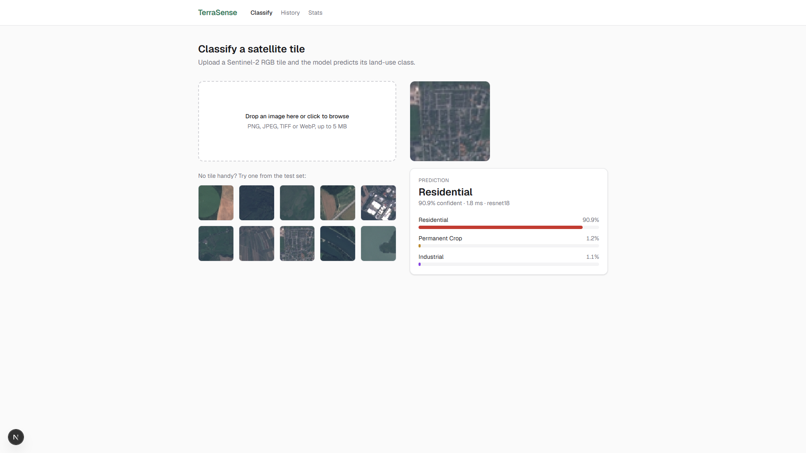
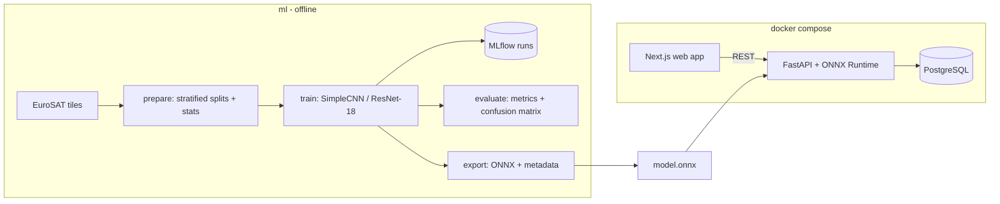
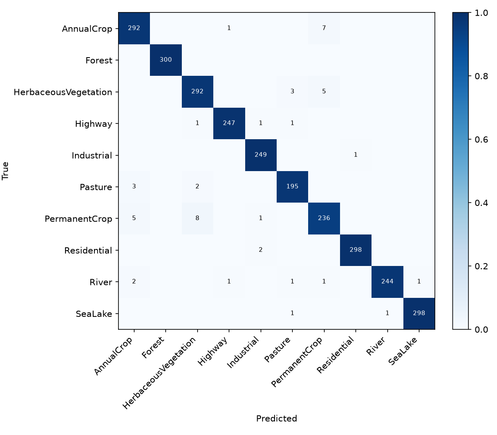
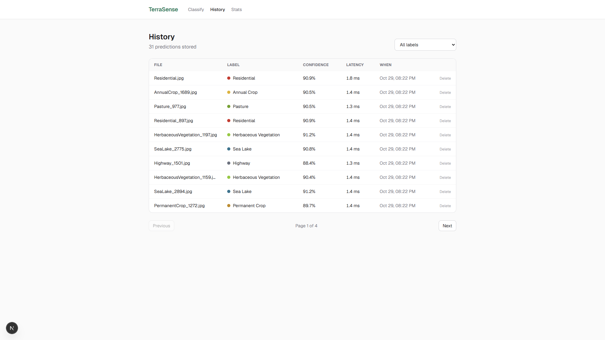
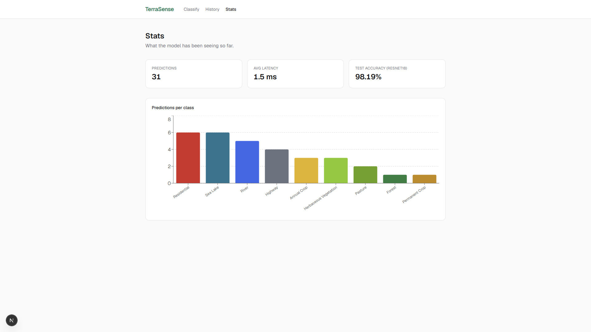

# TerraSense

[](https://github.com/Huypham310/terrasense/actions/workflows/ci.yml)

Land-use classification for Sentinel-2 satellite imagery. TerraSense trains convolutional neural networks on the [EuroSAT](https://github.com/phelber/EuroSAT) dataset, tracks experiments with MLflow, exports the best model to ONNX, and serves predictions through a FastAPI service with a Next.js frontend.



## Highlights

- **98.19% test accuracy** (macro F1 0.981) on 2,700 held-out EuroSAT tiles with a fine-tuned ResNet-18, vs 96.48% for a 289K-parameter CNN trained from scratch
- **1.5 ms per tile on CPU** with ONNX Runtime, ~3x faster than PyTorch, with outputs matching within 1e-6
- **API image without PyTorch**: inference only needs `onnxruntime`, the model ships as a [GitHub release](https://github.com/Huypham310/terrasense/releases/tag/model-v1)
- **69 automated tests** across the training package (81% coverage), API (98%) and web app (71%), run by GitHub Actions on every push

## Architecture



| Folder | What it is | Stack |
| --- | --- | --- |
| `ml/` | Data pipeline, models, training, evaluation, ONNX export | PyTorch, torchvision, scikit-learn, MLflow, ONNX |
| `api/` | Inference service with prediction history | FastAPI, ONNX Runtime, SQLAlchemy, PostgreSQL |
| `web/` | Upload, history and stats pages | Next.js (App Router), TypeScript, Tailwind, Recharts |

## How to run

You don't need to train anything: the trained model is attached to the [model-v1 release](https://github.com/Huypham310/terrasense/releases/tag/model-v1).

**Requirements**: Git, plus either Docker Desktop (option A) or Python 3.11+ and Node.js 20.9+ (option B).

### 1. Get the code and the model

```bash
git clone https://github.com/Huypham310/terrasense.git
cd terrasense
mkdir -p artifacts
curl -L -o artifacts/model.onnx https://github.com/Huypham310/terrasense/releases/download/model-v1/model.onnx
curl -L -o artifacts/model_meta.json https://github.com/Huypham310/terrasense/releases/download/model-v1/model_meta.json
```

On Windows PowerShell, `curl` works too (it's built into Windows 10+); use `mkdir artifacts` instead of `mkdir -p artifacts`.

### 2a. Option A: Docker (one command)

```bash
docker compose up --build
```

This starts Postgres, the API on http://localhost:8000 and the web app on http://localhost:3000. Stop everything with `docker compose down` (add `-v` to also delete the prediction history).

### 2b. Option B: run locally without Docker

No Postgres needed: the API falls back to a local SQLite file. Use two terminals from the repo root.

Terminal 1, the API:

```bash
python -m venv .venv
.venv\Scripts\activate            # Windows
# source .venv/bin/activate       # macOS / Linux
pip install -r api/requirements.txt
cd api
uvicorn app.main:app --port 8000
```

Terminal 2, the web app:

```bash
cd web
npm install
npm run dev
```

### 3. Use it

1. Open http://localhost:3000.
2. Drop a satellite tile (PNG/JPEG/TIFF/WebP) on the upload box, or click one of the 10 sample tiles under it. The predicted land-use class and the top-3 probabilities show up on the right.
3. **History** lists every prediction (filter by class, page through, delete rows).
4. **Stats** shows how many tiles were classified per class, average latency, and the model's test accuracy.
5. The API is also usable on its own: interactive docs at http://localhost:8000/docs, or

```bash
curl -F "file=@web/public/samples/River.jpg" http://localhost:8000/predict
```

### Retraining the model (optional)

Takes about 10 minutes on a laptop CPU, see [Dataset](#dataset) and [Training](#training) for details:

```bash
pip install -e "ml[dev]"
cd ml
python -m terrasense.data.prepare
python -m terrasense.train --model resnet18 --epochs 8 --lr 5e-4
python -m terrasense.evaluate --model resnet18
python -m terrasense.export --model resnet18   # writes artifacts/model.onnx + model_meta.json
```

### Troubleshooting

| Symptom | Fix |
| --- | --- |
| Web app says "Can't reach the API" | The API isn't running on port 8000, or `NEXT_PUBLIC_API_URL` points elsewhere |
| `/predict` returns 503 "Model is not loaded" | `artifacts/model.onnx` or `artifacts/model_meta.json` is missing; redo step 1 and restart the API |
| `/health` shows `"database": false` | With Docker, wait for the `db` container to become healthy; locally, check `TERRASENSE_DATABASE_URL` |
| Port 3000 or 8000 already in use | Stop the other process, or run `uvicorn ... --port 8001` and set `NEXT_PUBLIC_API_URL=http://localhost:8001` |

## Dataset

EuroSAT RGB contains 27,000 labeled 64x64 Sentinel-2 tiles across 10 land-use classes (AnnualCrop, Forest, HerbaceousVegetation, Highway, Industrial, Pasture, PermanentCrop, Residential, River, SeaLake).

| Split | Images |
| --- | --- |
| Train | 21,600 |
| Validation | 2,700 |
| Test | 2,700 |

Splits are stratified (seed 42), so every class keeps the same proportion in each split. Normalization statistics are computed on the training split only.

```bash
python -m venv .venv
.venv/Scripts/activate        # source .venv/bin/activate on macOS/Linux
pip install -e "ml[dev]"
cd ml && python -m terrasense.data.prepare
```

This downloads the dataset (~90 MB) to `data/raw/` and writes `data/processed/splits.json` and `stats.json`.

## Training

Two models are compared:

- `simple_cnn`: a small VGG-style CNN trained from scratch (3 conv blocks + global average pooling)
- `resnet18`: ImageNet-pretrained ResNet-18, fully fine-tuned

```bash
cd ml
python -m terrasense.train --model simple_cnn --epochs 15 --patience 4
python -m terrasense.train --model resnet18 --epochs 8 --lr 5e-4
python -m terrasense.evaluate --model resnet18
python -m terrasense.export --model resnet18
```

Training uses AdamW, cosine LR decay, label smoothing 0.1 and early stopping on validation accuracy. Every run is logged to MLflow (`mlflow.db` + `mlruns/`); browse them with `mlflow ui --backend-store-uri sqlite:///mlflow.db`. On a 12-thread laptop CPU, ResNet-18 trains in about 8 minutes and the baseline in about 19.

## Results

Test split (2,700 images never seen during training or model selection), CPU latency measured on a single 64x64 image after warm-up:

| Model | Test accuracy | Macro F1 | Params | PyTorch latency | ONNX Runtime latency |
| --- | --- | --- | --- | --- | --- |
| simple_cnn | 96.48% | 0.964 | 289K | 1.74 ms | 0.79 ms |
| resnet18 | **98.19%** | **0.981** | 11.2M | 4.83 ms | 1.48 ms |

Transfer learning cuts the test error roughly in half. Most remaining mistakes are between the agricultural classes (PermanentCrop vs HerbaceousVegetation / AnnualCrop), which look very similar at 64x64.



Full metrics, including per-class F1, are in `reports/<model>/metrics.json`.

## API

```bash
cd api
pip install -r requirements.txt
uvicorn app.main:app --reload
```

| Method | Path | Description |
| --- | --- | --- |
| GET | `/health` | Model + database status |
| GET | `/model` | Model name, classes, input size, test accuracy |
| POST | `/predict` | Classify one tile (multipart `file`), returns top-3 |
| POST | `/predict/batch` | Classify up to 16 tiles in one call |
| GET | `/predictions` | History, newest first (`limit`, `offset`, `label`) |
| GET | `/predictions/{id}` | One prediction |
| DELETE | `/predictions/{id}` | Delete a prediction |
| GET | `/stats` | Counts and average confidence per label |

Uploads are limited to PNG/JPEG/TIFF/WebP and 5 MB (`415` / `413` otherwise); unreadable images return `422`. The database is SQLite by default and PostgreSQL via `TERRASENSE_DATABASE_URL`; see `api/.env.example` for all settings.

## Web app

```bash
cd web
npm install
npm run dev        # http://localhost:3000, expects the API on :8000
```

| History | Stats |
| --- | --- |
|  |  |

Set `NEXT_PUBLIC_API_URL` to point at a different API. Confidence tops out around 91-92% even for easy tiles because the model was trained with label smoothing 0.1, which keeps it from being overconfident.

## Testing

| Part | Tests | Coverage | Command |
| --- | --- | --- | --- |
| `ml/` (pytest) | 23 | 81% | `cd ml && pytest --cov` |
| `api/` (pytest) | 25 | 98% | `cd api && pytest --cov` |
| `web/` (Vitest + Testing Library) | 21 | 71% lines | `cd web && npm run coverage` |

None of the tests need the real dataset or the trained model:

- ML tests run the full train -> evaluate -> ONNX export pipeline on 200 random fake tiles, with MLflow and artifacts redirected to a temp dir.
- API tests build a ~1 KB ONNX model on the fly (global average pool + linear layer) whose output is predictable from the tile's color, so the expected class is known.
- Web tests mock the API client and cover the classify flow, error states, history paging/filtering, and delete.

GitHub Actions runs ruff/ESLint/tsc and all three suites on every push and pull request.

## Limitations and future work

- Only the RGB bands are used; the multispectral EuroSAT version (13 bands) would likely separate the crop classes better.
- Tiles must be 64x64-ish patches; classifying a large scene would need a sliding-window tiler.
- No auth on the API, so it's meant for local or internal use.
- Possible next steps: quantize the ONNX model (int8) for even faster CPU inference, and add Grad-CAM heatmaps to the result card.

## Acknowledgements

EuroSAT: Helber, P., Bischke, B., Dengel, A., Borth, D. *EuroSAT: A Novel Dataset and Deep Learning Benchmark for Land Use and Land Cover Classification.* IEEE JSTARS, 2019. Sample tiles in `web/public/samples` come from its test split.

## License

MIT
